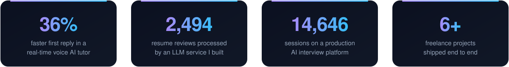

&nbsp;&nbsp;&nbsp;&nbsp;&nbsp;&nbsp;&nbsp;&nbsp;

## Hi, I'm Prakhar

I'm a full-stack software engineer who likes the places where modern web engineering meets AI: real-time voice, LLM pipelines, and the cloud infrastructure that keeps them dependable.

- **What I do:** build features across the stack in TypeScript / Next.js, Java / Spring Boot and Python / FastAPI, on Google Cloud.
- **What I care about:** latency, deterministic behaviour, caching, clean API contracts and production reliability.
- **What I'm exploring:** agentic systems and real-time multimodal AI.
- **Background:** B.Tech in Computer Science (AI & ML), VIT Bhopal University, CGPA 8.2/10. Based in India.

## Things I've built

<table>
  <tr>
    <td width="50%" valign="top">
      <h3>Real-time voice + vision AI tutor</h3>
      
A tutor that holds a live spoken conversation and grades answers against both speech and camera, driven by a deterministic conversation-graph engine.

      
<b>2.46 s → 1.58 s</b> time to first reply (−36%) by moving grading off the critical path.

      <code>Gemini Live</code> <code>Python</code> <code>FastAPI</code> <code>WebSockets</code>
    </td>
    <td width="50%" valign="top">
      <h3>Per-client data residency on GCP</h3>
      
A deployment design that keeps each client's data in its own GCP project, with a Terraform module and least-privilege IAM.

      
<b>Fail-closed config:</b> a missing setting stops startup instead of writing to a shared database.

      <code>GCP</code> <code>Terraform</code> <code>Cloud SQL</code> <code>Redis</code> <code>Secret Manager</code>
    </td>
  </tr>
  <tr>
    <td width="50%" valign="top">
      <h3>LLM resume evaluation</h3>
      
A scoring service that extracts PDFs, scores sections and role relevance at low temperature, and caches results so the same resume always gets the same score.

      
<b>2,494</b> resume reviews processed.

      <code>Spring Boot</code> <code>OpenAI</code> <code>Redis</code>
    </td>
    <td width="50%" valign="top">
      <h3>Hands-free AI interviews</h3>
      
A real-time interview client with a hands-free mode: speech recognition in the browser and a turn-completion classifier with timeouts, rate limiting and a voice-activity fallback.

      
<b>14,646</b> sessions on the platform, <b>82.5%</b> completed.

      <code>Next.js</code> <code>TypeScript</code> <code>Web Audio</code> <code>ElevenLabs</code>
    </td>
  </tr>
</table>

<b>More</b>

 

- **LLM content pipeline:** a 3-stage chain (planner, step expander, pushback) that turns a source document into structured YAML, slides and a ready-to-run mock interview with one API call.
- **Goal-planning feature for 2,000+ users:** full-stack, with drafts that survive a refresh, task APIs and PDF export.
- **Interactive lab simulators:** welding and electrical simulators and a circuit editor, built on Zustand + Immer and tested with Vitest.
- **Freelance:** 6+ independent web projects, taken from requirements to delivery.

## Toolbox

| | |
|---|---|
| **Languages** |  |
| **Frontend** |  |
| **Backend** |  |
| **Data & Cloud** |  |
| **AI & Voice** | OpenAI · Gemini Live · Groq · ElevenLabs · Sarvam TTS · Kokoro TTS |
| **Also** | Zustand · MUI · Framer Motion · Highcharts · Recharts · React Flow · Agora · Clerk · Vitest · Git |

---

---

&nbsp;&nbsp;

